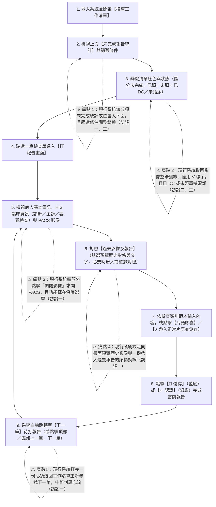

# 醫療影像報告系統設計（課程案例）

- **雛型網址**：[https://madeintw886.github.io/report-yzl/](https://madeintw886.github.io/report-yzl/)
- **設計系統規範**：[`design-system.md`](design-system.md) ／ [`tokens.css`](tokens.css) ／ [`.agents/skills/design-system/SKILL.md`](.agents/skills/design-system/SKILL.md)
- **AI 協作日誌**：[`ai-log.md`](ai-log.md)

---

## 1. 使用者研究

### 醫師人物誌（Persona：放射科報告醫師 —— 醫師甲）

- **角色與主要職責**：
  - **【來自訪談】** 放射科報告醫師，負責從工作清單檢視病人影像（門診放射、健檢胸部 X 光數位攝影、健檢 2D+3D 乳房攝影等）、撰寫報告並完成正式簽發「認證」回傳醫院資訊系統（HIS）（案例背景、訪談一）。
- **工作環境與高頻習慣**：
  - **【來自訪談】** 一天需連續處理多種類別的檢查報告，進入系統時希望預設帶入自己（「登入者：醫師甲」）的未完成清單，並依檢查日期及時間排序（訪談一）。
  - **【來自訪談】** 高度重視「不中斷的連續打報告動線」：希望從工作清單點選檢查單就**直接開啟 PACS 影像**（免點「調閱影像」按鈕），且在「儲存、認證」按鈕旁就能按「上一筆、下一筆」或儲存後自動跳下一筆，不必反覆退回工作清單（訪談一第一次與第二次補充）。
  - **【推論與推測】** 醫師在判讀影像時視線集中於 PACS 影像與報告文字區，對需要進入深層選單、頻繁移動滑鼠或因版面跳動而改變按鈕位置的操作極為敏感。
- **核心目標與擔憂**：
  - **【來自訪談】** 希望能一眼掌握「還有多少份報告還沒打（含總數與各檢查類別分項數量）」，且不要放在畫面太下面（訪談一第二次補充 2）。
  - **【來自訪談】** 擔心放射師未正確分派報告醫師而漏打報告，因此需要能隨時以日期搜尋當天清單，或切換查看「未指派／全部報告醫師」的檢查單（訪談一第二次補充 4）。
  - **【來自訪談】** 要求醫師介面與放射師介面明確區隔，避免放射師取回影像、排班指派等行政功能干擾打報告畫面（訪談一第二次補充 1）。

---

### 醫師任務流程

以下流程圖描繪報告醫師從開啟工作清單到完成多份報告的完整動線，並標示現行系統痛點發生的步驟（⚠️ 紅色節點）：

---

### 痛點

| 痛點 | 出處 | 對醫師的影響 |
| --- | --- | --- |
| **1. 缺乏明顯的未完成報告總數與分項統計** | 訪談一（第二次補充 2）：「要分不同的報告項目，看到還有多少份報告還沒有打，要有分項數量及總數量，不要放到太下面，數量要明顯一點」 | 醫師無法一眼掌握今日各檢查類別（胸 X、乳攝、門診、心超、頸超）的剩餘工作量，容易產生焦慮或漏看特定類別。 |
| **2. 常用功能藏在選單、篩選條件調整繁瑣** | 訪談一（第一次）：「現行系統將很多功能藏在選單中，不是很方便」；訪談三：「目前調整篩選條件非常麻煩」 | 增加無謂的滑鼠點擊與記憶負擔，切換不同檢查類別或查詢當天未指派清單時耗時費力。 |
| **3. 清單狀態標示不清，已 DC 與未照單據混亂** | 訪談二：「目前取回影像會整筆變成綠色，影像及報告欄位會以 V 方式來標註是否完成」；訪談二、三對已 DC 單據之抱怨 | 整列綠色加「V」記號無法區分「影像已到但報告未打」、「已完成暫存」與「已正式認證」，且已取消（DC）或未照影像的單據干擾醫師挑選待打報告。 |
| **4. 進入打報告畫面需手動點「調閱影像」** | 訪談一（第二次補充 5）：「打報告時影像直接呈現，無須醫師點『調閱影像』」 | 每打一份報告都要多按一次調閱影像並等待載入，一天數十份報告累積大量重複操作成本。 |
| **5. 無法在同一畫面順暢預覽過去影像與帶入歷史報告** | 訪談一（第一次 & 第二次補充 3）：「列出過去報告的清單，點選後能預覽，確認後能直接帶入」、「過去的影像含報告，在打報告頁面可查詢」 | 比較病灶變化或引用舊報告描述時，需跨視窗切換查詢，容易打斷判讀思緒。 |
| **6. 儲存／認證後無法直接跳下一筆報告** | 訪談一（第一次 & 第二次補充 7、8）：「在儲存、認證按鈕旁能有『上一筆』『下一筆』，直接跳到下一筆要打的報告，不需要再回到清單」 | 每完成一份報告都必須退回清單、重新捲動定位下一筆，嚴重破壞連續打報告的專注度與效率。 |

---

## 2. 需求矛盾與設計決定

訪談記錄中存在同一受訪者前後更正、以及不同角色對清單呈現規則與工作流程的矛盾，本系統之設計決定與理由如下：

| 議題 | 不一致的說法 | 我的設計決定 | 理由 |
| --- | --- | --- | --- |
| **1. 門診放射科報告是否需要範本與片語？** | **【來自訪談】** 醫師甲在第一次訪談說門診放射報告「只需要 Finding、Impression 兩大欄位，不需要片語」；但在六週後的第二次補充更正為「門診放射科報告範本要有範本與片語設定」。 | **採用第二次補充之更正**：為「門診放射」建立 `Finding` 與 `Impression` 兩大獨立欄位，並配置常用臨床片語膠囊（如 `No active lung lesion.`、`No obvious bony abnormality.`、`No significant abnormality.`）。 | **【來自訪談】** 第二次補充為受訪者深思後的明確更正；且提供片語膠囊與「`⚡ 帶入正常片語並儲存`」能讓門診正常個案與健檢個案享有同等的高效率。 |
| **2. 已 DC（取消醫令）與未照影像的檢查單是否顯示於工作清單？** | **【來自訪談】** 放射師認為「已 DC 若已照仍保留在清單上並標示已 DC，未照則從清單移除」（訪談二）；但超音波技術員乙認為「已 DC 的醫令單不要出現在清單上」（訪談三）；同時醫師甲又擔心漏單需查詢當天完整清單（訪談一）。 | **預設隱藏、並提供雙層控制開關**： 1. 工作清單預設隱藏「已 DC」與「未照影像」單據，保持待打清單乾淨。 2. 在工作清單標題列右側提供「`顯示: 醫令已DC / 未照影像`」勾選開關，展開後以粉紅底「`🚫 已DC`」與薰衣草紫底「`⏳ 未照`」明確標示。 3. 在上方統計看板提供「`計入: 醫令已 DC / 未照影像 / 未指派／其他醫師`」勾選開關。 | **【推論與推測】** 報告醫師日常最核心的任務是完成「正常醫令且已照影像」的報告，預設過濾可滿足技術員乙與醫師對清單整潔的需求；而保留一鍵顯示與計入開關，則兼顧了放射師對「已照但 DC（如 `R0004`）」的追蹤需求與醫師甲查核漏單的需求。 |
| **3. 帶入片語或按下儲存時，是否立刻自動跳轉下一筆？** | **【來自訪談】** 醫師甲第二次補充提到「7. 打報告選片語，醫師選擇帶入後，按確認即跳下一筆」以及「8. 打報告頁面儲存後即跳下一筆」，但若還在點擊個別欄位（如 `Lung`、`Others`）片語時就立刻跳走，會導致整份報告尚未填完就被迫切換。 | **分流「單欄片語累加」與「整份正常快篩跳轉」**： 1. 點擊各欄位上方的片語膠囊時，文字會附加至該欄位並停留在原畫面，讓醫師可繼續編輯其他欄位。 2. 底部操作列獨立設置「`⚡ 帶入正常片語並儲存`」按鈕，一鍵填入所有欄位的預設正常片語、設為已完成並直接跳轉至下一筆。 3. 點擊底部「`💾 儲存`」或「`✅ 認證`」時，系統儲存當前狀態並自動跳轉至下一筆未完成報告。 | **【推論與推測】** 區分「局部欄位的片語帶入」與「整份報告的快速完成跳轉」，既能實現醫師甲對正常片語一鍵完稿跳下一筆的期待，又能避免多欄位報告（如健檢胸 X 三個欄位）才點第一個欄位就誤跳下一筆的操作錯誤。 |
| **4. 報告狀態「已完成（Check 階段）」與「已認證」之區隔** | **【來自訪談】** 醫師甲主要提到「儲存、認證」；而技術員乙特別強調「要有 check 階段的註記，用來註記醫師打好的報告是不是已再次 check 過」且「已認證的報告如果要通知醫師重打，必須取消認證，讓報告再次回到未完成清單」（訪談三）。 | **建立三階段狀態與色彩雙重編碼**： 1. `⏳ 未完成`（暖黃 `#FFE59A`） 2. `💾 已完成`（天空藍 `#A9D3FF`，對應底部藍色「`💾 儲存`」按鈕，代表已初步完稿待確認／Check） 3. `✅ 已認證`（薄荷綠 `#B7E1D1`，對應底部綠色「`✅ 認證`」按鈕，且已認證報告在編輯區提供「`↩️ 取消認證（退回未完成重打）`」按鈕）。 | **【來自訪談＋推論】** 透過明確區分藍色「儲存（已完成）」與綠色「認證（已認證）」，並讓按鈕底色與狀態標籤底色完全一致，讓醫師與技術員都能一眼辨識報告處於暫存完稿或正式簽發階段，並支援退回重打流程。 |

---

## 3. 設計範圍

- **本設計涵蓋（基礎軌必做 ＋ 進階軌多項實作）**：
  1. **角色切換與醫師專屬工作清單（`#view-worklist`）**：
     - 頂部導覽列支援切換「`登入者：醫師甲 / 醫師丙`」，自動同步篩選器與未完成統計。
     - **單行未完成報告統計看板（`.summary-banner`）**：即時統計「總數」與五類檢查（健檢胸 X、健檢乳攝、門診放射、心超、頸超）未完成數量，點擊字卡可快速篩選該類別；右側可勾選是否計入「`醫令已 DC`」、「`未照影像`」、「`未指派／其他醫師`」。
     - **整合式篩選與檢查工作清單卡片（`.table-card`）**：單行快速篩選（依檢查日期／依報告日期、日期區間、報告狀態、檢查類別、開單單位、開單醫師、報告醫師、單號／身分證／姓名關鍵字、「`清除篩選條件`」）、全欄位點擊排序（預設依「檢查日期時間」降冪 `▼` 排序，且同步帶入打報告上下筆佇列）、7 種狀態底色圖例說明（依**醫令狀態 → 影像狀態 → 報告狀態 → 未指派**排序：`🚫 已DC`、`📷 已照`、`⏳ 未照`、`⏳ 未完成`、`💾 已完成`、`✅ 已認證`、`⚠️ 未指派`），以及未指派檢查單之「指派給我」快速接單功能。
  2. **整合式單卡打報告工作台（`#view-report` → `.report-main-card`）**：
     - **頂部進度導覽列（`.report-top-nav`）**：單行顯示「`返回工作清單`」、當前佇列位置，以及可點擊切換的「`⬅️ 上一筆：...`」與「`➡️ 下一筆：...`」膠囊按鈕（過長自動省略號截斷，不換行）。
     - **病人資訊橫幅（`.patient-banner`）**：單行呈現病人姓名、性別／年齡、身分證號、單號、檢查名稱、檢查日期時間與報告醫師，門診個案自動附加顯示 HIS 臨床資訊（`診斷：`、`主訴：`、`客觀檢查：`）。
     - **PACS 醫療影像互動檢視器（`.pacs-panel`）**：進入打報告畫面自動呈現對應類別之高擬真醫療 SVG 影像，右上角顯示即時參數（`W/L | Zoom | Series`），下方配置**單行工具列**（`➖ 縮小`、`➕ 放大`、`⛶ 全螢幕`、`🔄 重置`、`↕️ 調整順序`、`▶️ 播放 / ⏸️ 暫停`、`隱藏 (F9)`），支援真實 **4 切面序列拖曳與按鈕調整順序**及**動態影像循環播放（Cine Loop）**。
     - **過去影像及報告面板（`.history-panel`）**：精簡列出歷史檢查日期與檢查名稱，點擊可展開預覽**歷史醫療影像（僅標示日期）與完整歷史報告內容**，再次點擊同一筆即可收合預覽；支援「`📋 帶入此份過去報告內容`」與「`🖼️ 與目前影像並排對照`」。
     - **結構化報告編輯區（`.editor-panel`）**：依檢查類別動態載入範本欄位（健檢胸 X：`Lung / Others / Suggestion`；健檢乳攝：`Findings / Diagnosis`；門診放射：`Finding / Impression`；心超／頸超：附帶過濾 `TR`、`PR` 後之 **SR 結構化量測數值面板**與一鍵帶入功能），每個欄位上方提供常用片語膠囊；底部單行操作列固定錨定於欄位下方（不受左側歷史預覽展開影響），依序提供「`⬅️ 上一筆`」、「`➡️ 下一筆`」、「`⚡ 帶入正常片語並儲存`」、「`💾 儲存`」（天空藍底）與「`✅ 認證`」（薄荷綠底），以及 `F9` 隱藏／顯示影像與 `Ctrl + Enter` 認證跳下一筆快捷鍵。
- **不涵蓋及原因**：
  - **【來自訪談／課程規範】** 真實醫療院所後端資料庫、真實 DICOM 伺服器連線、真實超音波儀器硬體連線、HIS 帳號權限認證與排班系統自動派單後端邏輯不在本課程前端雛型範圍內；上述跨系統整合需求（如 HIS 診斷／主訴／客觀檢查、超音波 SR 數值、PACS 切面調序與動態播放）皆以瀏覽器端高擬真互動資料與前端狀態機實作呈現。

---

## 4. 設計變數與回應

於第二週收到設計變數卡（[變數二：乳攝雙人判讀](設計變數卡_變數二_乳攝雙人判讀.pdf)），分析與回應如下：

### 變數二（全面調整）：健檢中心主任要求「健檢乳房攝影報告改為雙人判讀，不一致時由第三位醫師裁決」

- **收到的變數**：依品質管理要求，自下個月起，健檢乳房攝影報告改為雙人判讀。兩位醫師各自獨立判讀，BI-RADS 分類不一致時，由第三位醫師裁決後才能認證（實作於複製更新版雛型：[`index-dual-read.html`](index-dual-read.html)）。
- **影響分析**：
  1. **畫面影響（高）**：
     - **打報告畫面（健檢乳攝範本與編輯區）**：原本僅有 `Findings` 與 `Diagnosis` 兩個純文字框，系統無法自動比對兩位醫師的 `BI-RADS` 分級；且缺乏「雙線盲讀隔離」與「第三位醫師並排對照裁決區」。
     - **打報告畫面（底部單行操作列）**：乳攝必須「兩線判讀一致」或「第三人裁決後」才能認證，單一判讀醫師不可直接簽發認證。
     - **工作清單畫面（狀態標籤、表格欄位與統計看板）**：原本的單一 `reportDoctor` 欄位與三種報告狀態無法表達「其中一線完成、等待另一線（`👥 1/2 已判讀`）」與「兩線 `BI-RADS` 不一致待第三人裁決（`⚖️ 待裁決`）」，且頂部登入者切換需擴充第 3 位裁決醫師角色（`醫師乙`）。
  2. **流程影響（高）**：「健檢乳攝」由單人線性簽發（`未完成 → 已完成 → 已認證`）改為**雙線平行獨立判讀＋系統自動比對狀態機**（`判讀線 A（醫師甲）與判讀線 B（醫師丙）各自獨立撰寫並提交報告` ➔ `當兩線皆完成時，系統自動比對兩線 BI-RADS 分類` ➔ `一致則系統自動完成認證` ／ `不一致則自動轉入待裁決並派發給第三位醫師（醫師乙）裁決認證`）。
  3. **人物誌影響（中）**：報告醫師在健檢乳攝中分別擔任「獨立判讀醫師（醫師甲、醫師丙）」或「第三位裁決醫師（醫師乙）」，兩位判讀醫師無須互相等待先後順序，各自於工作清單完成自己那條線的判讀即可；裁決醫師則專注於對照兩線差異並快速拍板認證。
  4. **對先前設計決定的影響（中～高）**：需在既有狀態系統上啟用第五種報告狀態色 `--status-arbitration-bg: #D9C2FF`（薰衣草紫 `⚖️ 待裁決`），並讓「`⚡ 帶入正常片語並儲存`」按鈕同步寫入 `BI-RADS = 1` 與推進雙線狀態機。
- **回應方式（全面調整）與具體設計決定及理由（[`index-dual-read.html`](index-dual-read.html)）**：
  1. **採用「雙線平行獨立判讀」而非「單線先後派單」工作流**：
     - **設計決定**：每筆健檢乳攝單自始同時指派予 `醫師甲` 與 `醫師丙` 兩條獨立判讀線。不論誰先登入，皆可在各自工作清單看到該筆檢查單並點擊「`撰寫報告`」獨立提交；當其中一線先完成時狀態標示為「`👥 1/2 已判讀`」（在篩選「全部狀態」或「已完成」時皆可見），另一線進入時自動盲讀隔離（隱藏已提交線之內容）；待**兩線皆完成報告**時，系統才自動比對兩線的 `BI-RADS` 分類並決定直接轉為「`✅ 已認證`」或發派予第三位醫師「`⚖️ 待裁決`」。
     - **理由（【來自訪談＋推論】）**：變數卡要求「兩位醫師各自獨立判讀」，若採單線依序派單（必須等醫師甲打完才出現在醫師丙清單），一旦第一位醫師休假或忙碌就會阻塞第二位醫師的判讀進度；改為雙線平行獨立作業，最符合臨床各自排程看片的彈性，且由系統在兩線完成當下自動比對分流，零人工交接延遲。
  2. **將 `BI-RADS 0 ~ 5` 按鈕直接配置於 `Diagnosis` 欄位下方，且不與 `Findings` 連動**：
     - **設計決定**：刪除頂部冗餘的雙人判讀流程說明卡片與 `Diagnosis` 原本的純文字片語按鈕，改將 `BI-RADS 0 ~ 5` 膠囊按鈕直接放在 `Diagnosis` 標題下方（右方小字精簡為「`必選分類`」）；點選 `BI-RADS` 按鈕僅自動帶入對應的 `Diagnosis` 標準分類文字，**不自動改動 `Findings` 欄位內容**。
     - **理由（【推論與推測：符合防錯原則與臨床撰寫習慣】）**：`BI-RADS` 本質上即為乳房攝影的最終診斷分類（`Diagnosis`），放在 `Diagnosis` 欄位內最符合視覺群組（Proximity）；同時醫師通常會先在 `Findings` 撰寫個別病灶或乳腺密度描述，若點選 `BI-RADS` 時強行覆寫或連動 `Findings`，反而會破壞醫師已輸入的客觀影像發現。
  3. **工作清單「報告醫師」、「報告狀態」、「操作」與「登入者」之極簡化呈現**：
     - **設計決定**：
       - **報告醫師欄位**：刪除醫師名稱冒號右方的子狀態文字；當報告仍在等待 `醫師甲`、`醫師丙` 撰寫（或兩線一致直接認證）時，僅顯示 `醫師甲`、`醫師丙`；**唯有當兩線不一致進入「`⚖️ 待裁決`」（或經裁決完成）時，才在欄位內加入顯示第三位醫師 `醫師乙`**。
       - **報告狀態欄位**：「`⏳ 未完成`」不額外顯示 `(0/2)`，「`✅ 已認證`」不額外顯示 `(雙讀完成)`，僅在其中一線完成時標示「`👥 1/2 已判讀`」，雙讀不一致時標示「`⚖️ 待裁決`」。
       - **操作欄位與登入者選單**：將乳攝待判讀的操作按鈕統一稱為「`撰寫報告`」（與一般檢查單一致），並刪除頂部「登入者」選單中醫師名稱右方的括號角色說明（僅留 `醫師甲`、`醫師丙`、`醫師乙`）。
     - **理由（【推論與推測：Nielsen 美學與極簡設計、一致性與標準】）**：「報告狀態」欄位已清楚承載進度資訊，若在「報告醫師」欄位重複塞入 `：⏳待判讀` 或在尚未進入裁決時就預先列出 `醫師乙`，會造成表格視覺雜訊與責任歸屬混淆；按需動態顯示 `醫師乙` 與統一用語能維持工作清單跨檢查類別的高度一致性。
  4. **第三人裁決畫面之「單鍵採納直接認證跳下一筆」與權限防呆限制**：
     - **設計決定**：
       - 在「`⚖️ 待裁決`」畫面的並排對照面板中，刪除右上角冗餘的「`系統自動比對結果：...`」文字與採納按鈕左側圖示，並移除畫面下方原有的「`帶入正常`」、「`暫存裁決草稿`」、「`需由第三位醫師裁決`」三顆按鈕。
       - 將兩線對照卡片下方的「`採納 醫師甲（BI-RADS ...）內容`」與「`採納 醫師丙（BI-RADS ...）內容`」設計為**一鍵拍板按鈕**：點擊後直接帶入該線報告內容、完成最終「`✅ 已認證`」，並立即自動跳轉至下一筆未打報告。
       - **權限限制**：嚴格限制**只有裁決醫師（`醫師乙`）登入時才能點擊裁決採納按鈕**；若目前登入者為原判讀醫師（`醫師甲`、`醫師丙`），按鈕將設為 `disabled` 鎖定不可按。
     - **理由（【來自訪談＋推論：極大化連續打報告效率與醫療品管防錯】）**：第三位裁決醫師的核心任務是在兩位醫師已寫好的報告與 `BI-RADS` 分類中做出最終裁定，讓「點擊採納按鈕 ＝ 直接完成認證並跳下一筆」，並移除下方多餘的暫存／帶入正常按鈕，能將裁決操作從原本的「點採納 ➔ 移到下方點完成認證（2 步）」濃縮為 **1 步完成並自動載入下一筆**，完美延續訪談一醫師強調的「不中斷連續打報告動線」；同時鎖定僅 `醫師乙` 可按，徹底落實品質管理「原判讀醫師不得自行裁決」的防錯要求。

---

## 5. 設計演進

### 第一版

- **核心架構**：建立單頁式雙視圖架構——「檢查工作清單視圖（`#view-worklist`）」與「打報告雙欄工作台視圖（`#view-report`）」。
- **完成基礎與進階需求**：實作未完成報告分類統計卡、多條件複合篩選、已 DC 與未照影像預設隱藏與開關、點選清單直接載入 PACS 影像、依檢查類別切換範本欄位、片語膠囊帶入、歷史報告預覽與帶入、超音波 SR 數值面板，以及儲存／認證後自動跳轉下一筆。

### 替代方案與選擇理由

1. **打報告畫面版面配置與「快速找到下一份要打的報告」動線（三種替代方案比較：[`report-layout-alternatives.html`](report-layout-alternatives.html)）**：
   - **方案 A（最終選擇：佇列膠囊專注型——單卡雙欄 ＋ 頂部／底部上下筆快跳）**：
     - **設計理念**：**【來自訪談】** 直接實作醫師甲提到的「B 醫院系統優點：列出目前打報告的資料及上一筆、下一筆資料」、「在儲存、認證按鈕旁能有『上一筆』『下一筆』，直接跳到下一筆要打的報告，不需要再回到清單」與「儲存後即跳下一筆」。**【推論與推測】** 將完整工作清單留在獨立首頁，打報告畫面 100% 面積保留給「左側 PACS 影像與過去報告」及「右側結構化報告表單」，僅在頂部導覽列放置單行不換行的「`⬅️ 上一筆 / 📍 目前 / ➡️ 下一筆`」上下文膠囊。
     - **優缺點評估**：依序打報告時，按下「`💾 儲存`」、「`✅ 認證`」或「`⚡ 帶入正常片語並儲存`」後**自動載入下一筆待打報告（0 額外步驟）**，手動點頂部或底部「`➡️ 下一筆`」也僅需 **1 步**，且 PACS 影像與報告文字區擁有最大視野（佔畫面 90% 以上）；缺點是僅能預見前後相鄰 1 筆，若要跨類別或跳選第 N 筆需點「返回工作清單」（2～3 步）。
   - **方案 B（三欄主從工作台——左側常駐待打佇列側欄 ＋ 中央 PACS ＋ 右側報告）**：
     - **設計理念**：結合「隨時看到分項待打數量」與「不回清單切換報告」，於左側固定 `310px` 寬常駐待打報告卡片佇列與分類統計膠囊。
     - **優缺點評估**：優點是跨筆跳選任意報告僅需 **1 步**，且分項未完成數量隨時可見；缺點是左欄吃掉約 22% 水平寬度，在一般筆電或單螢幕上會明顯擠壓中央 PACS 影像與右側片語區的寬度，且左側彩色卡片容易對判讀視線造成周邊視覺干擾。
   - **方案 C（上下分割清單連動型——上方常駐壓縮工作清單表格 ＋ 下方全寬度報告工作台）**：
     - **設計理念**：模仿傳統 RIS/PACS 上下雙視窗架構，上方固定約 `195px` 高度常駐精簡工作清單表格（含完整欄位與粉彩狀態底色），下方維持全寬度雙欄打報告區。
     - **優缺點評估**：優點是兼具全寬度影像／報告區與完整表格欄位對照，點擊上方表格列 **1 步**即可切換個案；缺點是上方表格佔用約 25%～30% 的垂直螢幕高度，導致下方多欄位報告（如健檢胸部 X 光三欄位）或展開歷史報告預覽時必須頻繁上下捲動，且垂直視線移動距離過長。
   - **選擇方案 A 的理由**：
     1. **【來自訪談】符合醫師「先在清單篩選排定順序、進入後專注連續打完」的真實工作流**：醫師甲在進入打報告畫面前，已透過工作清單上方的「未完成報告統計卡」或複合篩選器鎖定特定類別（如團檢胸部 X 光），進入打報告畫面後的核心訴求是「儲存／認證後自動跳下一筆」與「透過上一筆／下一筆快速切換」，無須在打報告同時一直盯著整張大表。
     2. **【推論與推測】極大化醫學影像判讀空間並維持空間穩定度**：看片與撰寫報告是高認知負荷任務，方案 A 不受左側欄（方案 B）或頂部表格（方案 C）擠壓，能提供最大的 PACS 檢視畫布與完整的三欄位無捲動編輯視野，避免醫師在連續打數十份報告時因版面擁擠或頻繁捲動而產生視覺疲勞。
2. **首頁上方控制區版面配置（多卡片分立 vs. 單行極簡整合卡片）**：
   - **方案 A（初版多卡片分立）**：將「未完成報告統計」做成雙行大字級卡片，「搜尋篩選面板」做成獨立多行卡片，下方再放「工作清單表格卡片」。缺點是上方控制區佔據超過 50% 的垂直螢幕高度，導致最重要的工作清單表格第一眼只能看到 3～4 筆。
   - **方案 B（最終選擇：單行統計橫幅 ＋ 搜尋與清單合一卡片）**：將「未完成報告統計」濃縮為單行緊湊橫幅（移除冗餘「份」單位，右側直接整合「`計入: 醫令已 DC / 未照影像 / 未指派／其他醫師`」），並將「搜尋篩選列」直接併入工作清單卡片（`.table-card`）頂部且維持單行不換行。
   - **選擇理由**：報告醫師的核心視覺焦點在於工作清單表格，方案 B 釋放了約 40% 的垂直空間，且將篩選器、狀態圖例與表格緊密整合於同一視覺容器內，掃視動線最短。
3. **狀態色彩編碼方式（整列塗色 vs. 狀態膠囊專屬粉彩底色）**：
   - **方案 A（現行系統整列變綠）**：整列塗滿同一種顏色，當「已 DC + 已照 + 未完成」同時發生時會產生色彩衝突。
   - **方案 B（最終選擇：高明度粉彩狀態膠囊 ＋ 圖示雙重編碼）**：定義 7 種獨立狀態底色（`🚫 已DC` 櫻花粉 `#FFB5C1`、`📷 已照` 淺暖灰 `#E6E2DC`、`⏳ 未照` 薰衣草紫 `#E2D5F8`、`⏳ 未完成` 暖黃 `#FFE59A`、`💾 已完成` 天空藍 `#A9D3FF`、`✅ 已認證` 薄荷綠 `#B7E1D1`、`⚠️ 未指派` 暖杏橘 `#FFD8B5`），並於工具列依「醫令狀態 → 影像狀態 → 報告狀態 → 未指派」順序直接將底色套用於圖例上。
   - **選擇理由**：符合無障礙設計（不單靠顏色，搭配專屬 Emoji 圖示），且能在一筆檢查單上同時清楚呈現醫令、影像與報告三個維度的狀態而不互相覆蓋。

### 啟發式評估與設計變數後的修改

1. **消除「給評分者看的教學式贅字」（違反 Nielsen 美學與極簡設計）**：
   - 刪除頂部「報告醫師專用介面 (UI 已與放射師端區隔)」、「重置模擬資料」、工作清單「(預設登入醫師甲)」、打報告畫面「📋 報告範本」標籤、PACS 頂部重複標題列，以及底部長篇「連續打報告跳轉規則」說明區塊，讓介面回歸真實臨床專業系統的乾淨度。
2. **修正工作清單預設降冪排序與打報告上下筆佇列不同步問題（違反一致性與標準）**：
   - 將工作清單「檢查日期時間」預設設為降冪排序（`▼` 最新日期在上），並同步修正 `getNavigableQueue()` 與 `findNextPendingExam()` 的排序邏輯，同時將打報告頁頂部的「`⬅️ 上一筆：...` / `➡️ 下一筆：...`」改為可點擊的 `<button>` 且加上省略號截斷，確保頂部與底部導覽行為完全一致。
3. **強化「已照 vs. 未照」之視覺對比（違反系統狀態可見性）**：
   - 修正早期版本圖例「未照」誤用相機圖示的問題（改為 `⏳ 未照`），並將常態的「`📷 已照`」設為低干擾淺暖灰（`#E6E2DC`）、異常待追蹤的「`⏳ 未照`」設為醒目薰衣草紫（`#E2D5F8`），讓缺片異常一眼可見。

### 可用性測試後的修改

1. **PACS 影像工具列單行化與「調整順序／動態播放」真實互動化**：
   - 移除影像畫布內部下方重複的縮放／全螢幕浮動按鈕，將 `W/L | Zoom | Series` 資訊視窗移至畫布右上角；畫布下方整合為**單行工具列**（依序為：`➖ 縮小`、`➕ 放大`、`⛶ 全螢幕`、`🔄 重置`、`↕️ 調整順序`、`▶️ 播放`、`隱藏 (F9)`），並實作真實的 **4 切面序列拖曳／按鈕調序面板**與**動態影像循環播放（Cine Loop）**。
2. **過去影像及報告之精簡呈現與雙向開合預覽**：
   - 將「過去報告參考」改名為「`📂 過去影像及報告`」，刪除清單項目左側冗餘的日曆圖示與預覽摘要文字（僅留檢查日期與檢查名稱）；點選預覽視窗時同時呈現**歷史醫療影像（僅標示日期）**與報告全文，並支援**再次點擊同一筆項目即可收合預覽視窗**。
3. **打報告工作台「四合一單卡整合」與底部按鈕位置固定（空間穩定度優化）**：
   - 將「病人資訊」、「PACS 影像畫面」、「過去影像及報告」與「打報告編輯區」整合進同一張主卡片（`.report-main-card`），減少破碎邊框。
   - 將底部操作列精簡為單行 5 顆按鈕（`⬅️ 上一筆`、`➡️ 下一筆`、`⚡ 帶入正常片語並儲存`、`💾 儲存`、`✅ 認證`），把「`💾 儲存`」改為與「`💾 已完成`」相同的天空藍底色（`#A9D3FF`），並將右側編輯面板設為頂部對齊（`justify-content: flex-start`），確保左側展開或收合歷史預覽視窗時，**右側打報告下方的操作按鈕位置絕對不會跟著上下跑動**。

