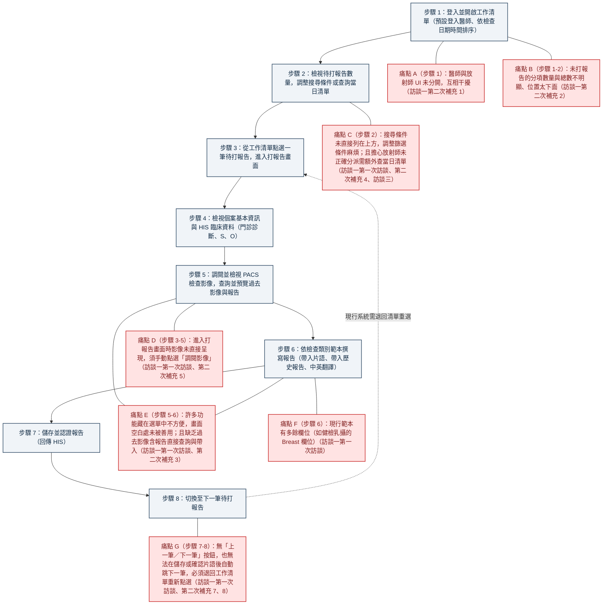

# 影像報告撰寫系統設計（課程案例）

雛型網址：https://madeintw886.github.io/report-yzl/

## 1. 使用者研究

### 醫師人物誌

* **角色代稱**：醫師甲（放射科報告醫師）（出處：案例資料 P.1「使用者角色」表、P.2 訪談一標題）
* **服務機構與主要職責**：任職於提供門診與健康檢查服務的醫療機構；負責檢視醫學影像（PACS）、撰寫並認證報告，認證完成後回傳醫院資訊系統（HIS）（出處：P.1「案例背景」、「使用者角色」表、P.2「名詞說明」）。
* **負責的檢查報告類型**：
  * 門診：放射科報告（如胸部 X 光正面、腹部 X 光）
  * 健檢：胸部 X 光數位攝影
  * 健檢：2D+3D 乳房攝影
  * （出處：P.2 訪談一 第一次訪談「會使用的範本」、P.6「檢查清單」模擬資料 `R0001`–`R0004`、`R0010`）
* **系統使用經驗與背景**：
  * 熟悉現行系統缺點，並具備其他醫院（A 醫院、B 醫院）系統的使用或觀察經驗，在訪談中主動提供 A 醫院工作清單、B 醫院工作清單與打報告畫面的截圖作為參考（出處：P.3 訪談一 第一次訪談「打報告畫面」與文末括號紀錄）。
  * **【推測】**：訪談未記載年齡與年資；但從熟悉多家醫院系統介面優缺點、且能明確指定各類門診與健檢報告欄位的取捨來看，推測為具備多年臨床閱片經驗的資深放射科醫師。
* **工作習慣與行為特徵**：
  * **從個人工作清單開始，按檢查日期時間順序處理**：預設登入醫師為報告醫師，預設依「檢查日期及時間」排序，並希望每個欄位皆可更改排序（出處：P.1「名詞說明」、P.2 訪談一 第一次訪談「工作清單需求」）。
  * **重視待辦工作量統計與視覺狀態區分**：希望清單依不同報告項目分類，在明顯位置看到還沒打的報告「分項數量」及「總數量」（不要放到太下面），並偏好依狀態呈現不同底色（出處：P.2 訪談一 第一次訪談「工作清單需求」、P.3 第二次補充第 2 點）。
  * **追求單一畫面、不中斷的高速連續打報告節奏**：希望點選報告即直接呈現 PACS 影像、無須點「調閱影像」；常用功能直接呈現在畫面空白處、不藏在選單中；善用「片語」帶入常用句子，並在儲存／認證或帶入片語確認後直接跳到下一筆應打報告，不必再回工作清單（出處：P.3 訪談一 第一次訪談「打報告畫面」、第二次補充第 5、7、8 點）。**【推測】**：日常門診與健檢待打報告量大、時間壓力高，對多餘點擊與頁面往返極為敏感。
  * **撰寫時需參照臨床資訊與過去影像／報告**：需檢視個案必要資訊（身分證號、姓名、性別、年齡、檢查名稱、開單日期、檢查日期時間、開單醫師）；門診個案需參照 HIS 的「診斷、S、O」；並會在打報告頁面查詢過去的影像含報告清單，預覽確認後直接帶入（出處：P.3 訪談一 第一次訪談「打報告畫面」、第二次補充第 3 點）。
  * **需要中英雙語轉換輔助**：撰寫報告時需要中翻英／英翻中功能輔助（出處：P.2 訪談一 第一次訪談「會使用的範本」、P.3 第二次補充第 6 點）。**【推測】**：臨床片語以英文為主，但健檢報告情境可能需提供受檢民眾中文說明或雙語互譯。
  * **對放射師分派流程保持防錯警覺**：雖由放射師分派指定報告給醫師撰打，但擔心放射師未正確分派，會主動以日期搜尋查詢當天報告清單以防漏單（出處：P.3 訪談一 第一次訪談「放射師分派報告功能」、第二次補充第 4 點）。

### 醫師任務流程

### 痛點

| 痛點 | 出處 | 對醫師的影響 |
| --- | --- | --- |
| 1. **醫師與放射師的 UI 未分開** | P.3 訪談一 第二次補充第 1 點 | 非醫師工作所需的放射師功能與資訊混雜在同一介面，造成視覺與操作互相干擾。 |
| 2. **未完成報告的分項數量與總數不明顯、放太下面** | P.3 訪談一 第二次補充第 2 點 | 無法在開啟清單時一眼掌握各報告項目還有多少份未打報告及今日整體工作量。 |
| 3. **搜尋條件未直接列在上方，調整篩選麻煩** | P.2 訪談一 第一次訪談「工作清單需求」；P.4 訪談三「清單需求」 | 隨時切換檢查類別、完成狀態或日期時操作繁瑣，降低查找清單的效率。 |
| 4. **擔心放射師未正確分派報告醫師** | P.3 訪談一 第二次補充第 4 點 | 若只看分派給自己的預設清單，可能因放射師漏分派或分派錯誤而漏打當日報告。 |
| 5. **看影像需手動點選「調閱影像」，未直接呈現** | P.3 訪談一 第一次訪談「打報告畫面」、第二次補充第 5 點 | 每打一份報告都要多點一次按鈕才能看圖，累積大量重複且不必要的點擊動作。 |
| 6. **常用功能藏在選單中，未善用畫面空白處** | P.3 訪談一 第一次訪談「打報告畫面」、第二次補充第 3 點 | 查詢過去影像含報告、帶入片語或翻譯時需頻繁點開選單翻找，打斷撰寫報告的思緒。 |
| 7. **報告範本包含不需要的多餘欄位** | P.2 訪談一 第一次訪談「會使用的範本」 | 如健檢 2D+3D 乳攝含有不需要的 `Breast` 欄位，增加畫面干擾與欄位切換負擔。 |
| 8. **完成報告後無法直接跳下一筆，需反覆退回工作清單** | P.3 訪談一 第一次訪談「打報告畫面」、第二次補充第 7、8 點 | 每完成一份報告都必須先回到工作清單、重新尋找並點選下一筆，嚴重拖慢連續打報告的節奏。 |

## 2. 需求矛盾與設計決定

| 議題 | 不一致的說法 | 我的設計決定 | 理由 |
| --- | --- | --- | --- |
| **1. 已 DC（取消）醫令單在清單上的處理方式** | • **放射師（P.4 訪談二）**：已照仍保留在清單上並標示醫令已 DC；未照從清單移除。 • **超音波技術員（P.4 訪談三）**：已 DC 的醫令單不要出現在清單上。 • **模擬資料（P.6）**：同時有已 DC 但已照（`R0004`）與已 DC 且未照（`R0008`）。 | 預設勾選移除「已 DC 且未照（`R0008`）」，保留「已 DC 但已照（`R0004`）」並以淡紅底色與 `🚫 已DC` 標籤警示；自動跳下一筆時，優先跳往「正常且已照」的未完成報告（`R0001` → `R0002` → `R0010`），最後才跳往 `R0004`。 | 兼顧放射科對「已照影像仍需留存紀錄」的實務需求（訪談二），同時避免醫師在連續打報告時誤把已取消開單的檢查當作一般正常案件優先處理。 |
| **2. 跳下一筆報告的觸發時機與操作方式** | • **醫師甲第一次訪談（P.3）**：在儲存、認證按鈕旁有「上一筆」「下一筆」手動跳轉。 • **醫師甲第二次補充第 7 點（P.3）**：打報告選片語，選擇帶入後按確認即跳下一筆。 • **醫師甲第二次補充第 8 點（P.3）**：打報告頁面儲存後即跳下一筆。 | 以底部「儲存／認證後自動跳下一筆未完成報告」作為預設主流程，同時保留頂部與底部的「← 上一筆／下一筆 →」按鈕，並在範本區右上角提供「帶入片語後顯示確認並跳下一筆提示」勾選開關。 | 多數報告範本包含 2 至 3 個欄位（如健檢胸 X 有 `Lung`、`Others`、`Suggestion`），若點擊單一欄位片語就強制跳下一筆，會導致其餘欄位無法填寫；透過勾選開關可同時支援多欄撰寫與單一片語快速完稿。 |
| **3. 門診放射科報告是否需要片語** | • **醫師甲第一次訪談（P.2）**：門診放射科報告不需要片語。 • **醫師甲第二次補充（P.3 文末）**：更正為門診放射科報告要有範本與片語設定。 | 依第二次補充更正，為「門診放射」範本（`Finding`、`Impression`）配置常用片語點擊帶入功能。 | 受訪者於第二次補充明確更正先前說法，且案例資料 P.7 亦提供門診放射的片語範例。 |
| **4. 中英翻譯功能的方向（中翻英 vs. 英翻中）** | • **醫師甲第一次訪談（P.2）**：健檢胸 X 與乳攝配合中翻英。 • **醫師甲第二次補充第 6 點（P.3）**：具備英翻中功能。 | 在報告範本面板右上角同時並列「中翻英（示意）」與「英翻中（示意）」兩顆按鈕。 | 畫面右上角空間充裕，直接並排呈現雙向翻譯按鈕可滿足不同情境下的中英互譯需求，且符合不把功能藏在選單中的原則。 |
| **5. 打報告畫面的影像開啟方式（直接呈現 vs. F9 開關）** | • **醫師甲（P.3 第一次訪談、第二次補充第 5 點）**：打報告時影像直接呈現，無須點「調閱影像」。 • **技術員乙（P.4 訪談三）**：在報告撰打畫面按 `F9` 可以開啟／關閉影像。 | 進入打報告畫面時預設直接呈現左側 PACS 影像示意區，同時在影像區標題列提供「開啟／關閉影像 (`F9`)」按鈕與鍵盤 `F9` 快捷鍵支援。 | 預設直接呈現滿足醫師免點擊看圖的核心需求，加上 `F9` 開關則兼顧鍵盤操作彈性，兩者互不衝突。 |
| **6. 儲存（已完成）與認證（已認證）的操作與狀態區分** | • **訪談一（P.2–3）**：搜尋條件提及「報告是否完成」，打報告按鈕提及「儲存、認證」。 • **模擬資料（P.6）**：報告狀態分為「未完成」、「已完成（`R0003`）」、「已認證（`R0005`）」。 | 底部同時提供「暫存草稿（留在原頁）」、「儲存（標為已完成並跳下一筆）」與「認證報告（標為已認證並跳下一筆）」三種按鈕。 | 完整對應模擬資料中的三種報告狀態，讓醫師可依情境選擇先儲存初稿或直接正式認證簽發。 |

## 3. 設計範圍

- **本設計涵蓋**：
  - **基礎軌（必做）**：
    - **醫師工作清單**：最上方明顯顯示未完成報告的**總數**與**各檢查類別分項數量**（支援點擊卡片快速篩選）；搜尋與篩選條件直接列在上方（報告醫師預設為 `醫師甲`，並提供「查詢當日全院清單」防漏分派按鈕）；全欄位點擊排序（預設依檢查日期時間排序）；依狀態呈現底色與已 DC 醫令處理。
    - **打報告畫面**：個案必要資訊與門診 HIS 臨床資料（診斷、S、O）；左側直接呈現 PACS 影像示意區；右側依檢查類別（健檢胸部X光、健檢乳攝、門診放射、心臟超音波、頸動脈超音波）自動切換範本欄位；常用片語點擊帶入；上一筆／下一筆切換；儲存或認證後自動跳到下一筆未完成報告。
  - **進階軌（已納入實作）**：
    - **無障礙設計（Accessibility）**：採用「選項 C：視覺降噪・焦點突顯色系」，所有狀態標籤文字與背景對比度皆達 WCAG AAA 標準（`7.6:1`–`8.9:1`），且每種狀態皆強制搭配**圖示符號＋文字＋邊框＋表格列左側 `4px` 狀態色條**（`⏳ 未完成`、`✓ 已完成`、`🔒 已認證`、`🚫 已DC`、`⚠️ 未指派`、`○ 未照`），不單靠顏色傳達狀態。
    - **報告狀態呈現**：在工作清單與打報告畫面中，以一致的狀態標籤、圖示與列左側色條呈現「未完成、已完成、已認證、醫令已 DC」等狀態，讓醫師一眼辨識。
    - **過去報告查詢、預覽與帶入**：於打報告畫面左側下方直接呈現過去影像與歷史報告預覽，點擊即可直接帶入目前報告欄位。
    - **鍵盤操作**：用 `F9` 開關影像。
- **不涵蓋及原因**：
  - **放射師介面**：因為本週的作業是做醫師介面。
  - **鍵盤操作（快捷鍵儲存並跳下一筆）**：因為還沒想好快捷鍵應該挑哪一個比較方便，所以尚未涵蓋。
  - **響應式版面**：因為醫師實際工作時，通常不會用平板看影像和打報告，所以沒有做。
  - **A/B 版本**：因為時間有限，暫時還沒涵蓋。

## 4. 設計變數與回應

- 收到的變數：
- 影響分析：
- 回應方式（全面調整／部分調整／協商）與理由：

## 5. 設計演進

### 第一版

1. **第一版初稿（v1.0 — 建立核心流程）**：
   - 針對報告醫師設計獨立於放射師的專用介面，包含「醫師工作清單」與「打報告畫面」。
   - 工作清單頂部配置「未完成報告總數與各檢查類別分項數量」統計卡，下方配置直接展開的搜尋篩選列與可排序表格。
   - 點選任一檢查即進入左圖右文的打報告畫面：左側直接呈現 PACS 影像示意區與過去報告預覽，右側依檢查類別切換對應範本欄位與片語，點擊「儲存」或「認證報告」後自動跳往下一筆未完成報告（`R0001` → `R0002` → `R0010`）。
2. **依迷你設計系統調整（v1.1 — 統一視覺規格與無障礙雙重編碼）**：
   - 建立 [tokens.css](./tokens.css) 與 [design-system.md](./design-system.md)，報告狀態語意色選定**選項 C（視覺降噪・焦點突顯色系）**。
   - **修正的一致性問題**：
     - 統一打報告畫面頂部與底部的切換按鈕為 `← 上一筆` / `下一筆 →`（`.btn-outline`）。
     - 統一「帶入常用片語」與「確認並帶入歷史報告」為膠囊狀按鈕（`.phrase-chip`）。
     - 將原本純紅字呈現的「報告醫師：未指派」統一改為 `⚠️ 未指派` 警示徽章（`.badge-dc`），跨工作清單與打報告畫面保持一致。
     - 將「已完成」與「已認證」的表格列底色改為純白背景搭配左側 `4px` 狀態色條，僅保留「`⏳ 未完成`」與「`🚫 已DC`」的微底色與高反差標籤，減少長時間看片的視覺疲勞，並落實「圖示＋文字＋色彩」無障礙雙重編碼。

### 替代方案與選擇理由

### 啟發式評估與設計變數後的修改

### 可用性測試後的修改
